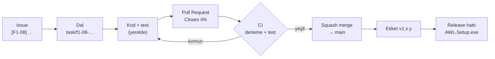

# Geliştirme Süreci

Bu belge AWL'nin GitHub üzerinde nasıl yönetildiğini anlatır: görevler, dallar, PR'lar ve CI/CD.

## 1. Genel akış



## 2. Görevlerin GitHub'daki yapısı

| Öğe | Kullanım |
|---|---|
| **Milestone** | Fazlar: `Faz 0 – Doğrulama`, `Faz 1 – MVP`, `Faz 2 – Gömülü terminal`, `Faz 3 – Araçlar` |
| **Issue başlığı** | Görev anahtarıyla başlar: `[F1-08] Claude komut satırı oluşturucu` |
| **Etiketler** | `tür: …` (özellik, altyapı, test, doğrulama, doküman, hata) · `alan: …` (kurulum, oturum, claude, terminal, python, belge, windows, arayüz, tanılama, ci-cd, araçlar) · `öncelik: …` (zorunlu, önemli, isteğe bağlı) |
| **Issue gövdesi** | Amaç · Yapılacaklar (onay kutulu) · Gereksinimler (SRS kimlikleri) · Kabul kriterleri · Bağımlılıklar (`#N`) |

Görev listesinin kaynağı [`.github/backlog/backlog.json`](../.github/backlog/backlog.json) dosyasıdır. Issue'lar bu dosyadan betikle oluşturulur:

```powershell
# Önce ne yapılacağını göster (GitHub'a hiçbir şey göndermez)
.\scripts\github\import-backlog.ps1 -Repo ahdude00/ai-workspace-launcher -DryRun

# Etiketleri, milestone'ları ve issue'ları oluştur (tekrar çalıştırılırsa var olanları atlar)
.\scripts\github\import-backlog.ps1 -Repo ahdude00/ai-workspace-launcher
```

**Faz 0 görevleri**, AWL'nin otomatik yapacağı işlerin (Claude Code, Python ve kütüphanelerin kurulumu gibi) kodlamaya başlamadan önce geliştiricinin kendi ortamında (kendi bilgisayarı veya Windows 10 sanal makinesi, standart kullanıcı hesabı) elle denenmesidir. Son kullanıcının bilgisayarında hiçbir test yapılmaz; ürün her şeyi ilk açılışta kendisi kurar. Kurulacağı bilgisayarlardaki kısıtlar (PowerShell dil modu, uygulama engelleme kuralları, proxy) önceden ölçülmez; AWL bunları ilk açılışta tespit eder, kullanıcıya açıklar ve tanılama paketine yazar. Sonuçlar issue'ya yorum olarak yazılır; bir karar değişirse karar günlüğü güncellenir.

## 3. Dal ve PR kuralları

- `main` her zaman derlenir ve testleri geçer. Doğrudan `main`'e commit atılmaz.
- Her görev için güncel `main`'den yeni bir dal açılır: `task/<anahtar>-<kısa-ad>`, ör. `task/f1-08-command-builder`.
- Bir dal tek bir issue'yu kapatır. PR açıklaması `Closes #N` içerir; merge olunca issue otomatik kapanır.
- PR'lar **squash merge** ile alınır (her görev `main`'de tek commit olur), ardından dal silinir.
- Commit mesajları [Conventional Commits](https://www.conventionalcommits.org/) biçimindedir: `feat(sessions): …`, `fix(setup): …`, `ci: …`, `docs: …`.

### Claude Code ile çalışırken

- Claude her görevde dalı açar, kodu yazar ve testleri çalıştırır.
- **Commit, push, PR açma ve merge işlemlerinin her biri için önce sorar**; onay almadan hiçbirini yapmaz. Bir onay yalnızca o işlem için geçerlidir.

## 4. CI — her push ve PR'da

`.github/workflows/ci.yml` (görev **F1-02** ile eklenir):

| İş | Çalıştığı yer | Ne yapar |
|---|---|---|
| `build-test` | `windows-latest` | .NET 10 kurulumu → `dotnet restore` → `dotnet build` (uyarılar = hata) → birim, mimari ve entegrasyon testleri → kapsam raporu (artifact) |
| `python-tests` | `ubuntu-latest` | `udf_tool.py` için `pytest` |
| `codeql` | `windows-latest` | C# güvenlik taraması (açık depolarda ücretsiz) |

`main` için bir **ruleset** tanımlanır (F1-02 sonunda):

- Doğrudan push yok; değişiklik yalnızca PR ile gelir.
- PR'ın merge edilebilmesi için `build-test` ve `python-tests` yeşil olmalı.
- Zorla push (force push) ve dal silme engellenir.
- Tek geliştirici olduğu için onay (review) sayısı 0'dır.

## 5. CD — sürüm yayınlama

`.github/workflows/release.yml` (görev **F1-30** ile eklenir). Otomatik güncelleme olmadığı için (D21) “dağıtım”, kurulum dosyasının üretilip bir Release sayfasına konmasıdır:

1. `main`'de sürüm numarası güncellenir ve etiket atılır: `git tag v1.0.0` → `git push origin v1.0.0` (bu adım da onayla yapılır).
2. Hat; uygulamayı self-contained derler, `third_party` bileşenlerini sabit sürüm ve SHA256 doğrulamasıyla indirir, Inno Setup ile `AWL-Setup-1.0.0.exe` üretir.
3. Kurulum dosyası ve SHA256 özeti bir **taslak Release**'e eklenir.
4. Taslak gözden geçirilip yayımlanır; kurulum dosyası kullanıcıya elle iletilir.

## 6. Bakım ve güvenlik

- **Dependabot:** NuGet paketleri ve GitHub Actions için haftalık güncelleme PR'ları (F1-02).
- **Secret scanning + push protection:** açık depolarda ücretsizdir; depo ayarlarından açık tutulur.
- Depoya ikili dosya (uv.exe, Windows Terminal ZIP) eklenmez; derleme sırasında indirilir.
- Tanılama paketleri veya örnek belgeler issue'lara eklenmeden önce kişisel veya gizli bilgi açısından kontrol edilir; depo herkese açıktır.
